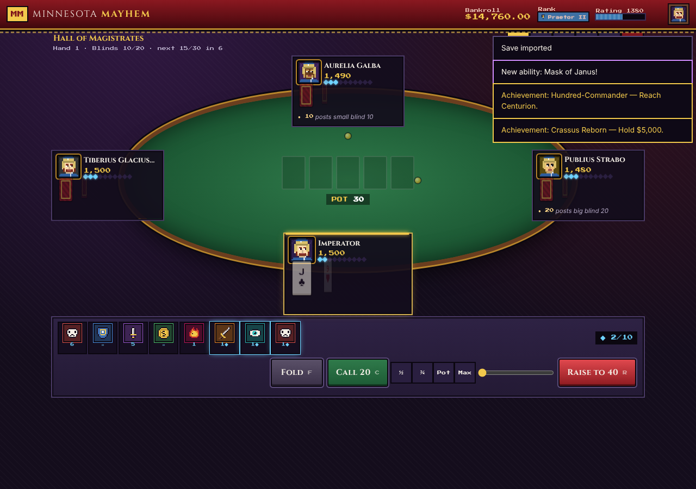
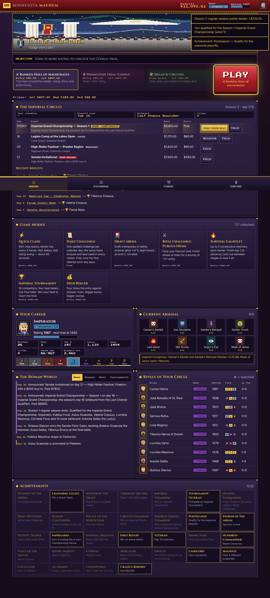
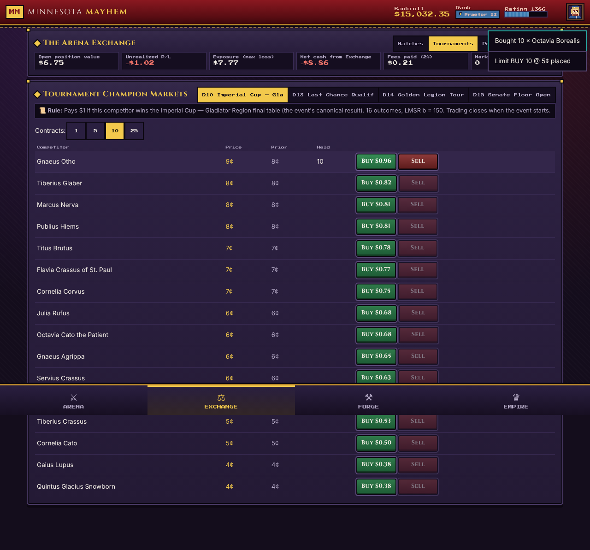
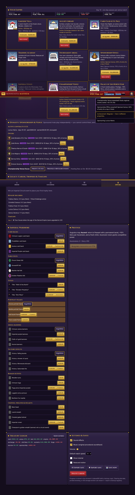
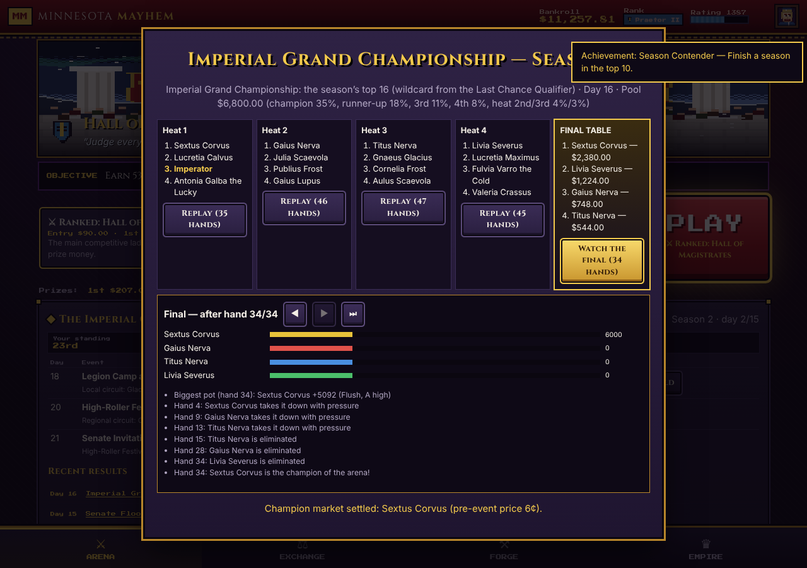
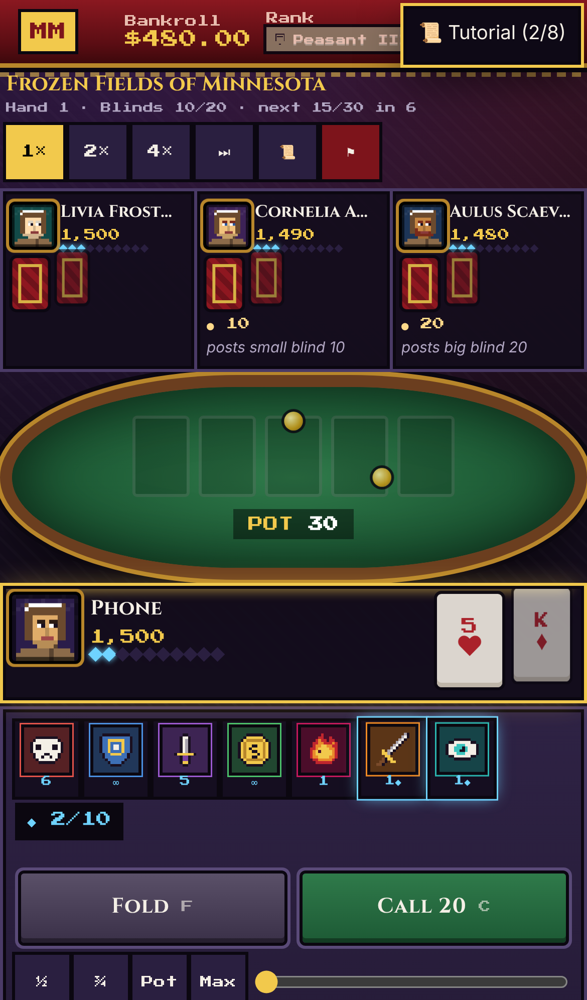

# MINNESOTA MAYHEM 3.0 — *THE ETERNAL EMPIRE*

*Roman Poker · Imperial Circuit · Legendary Arsenal · Grand Exchange · Dynasty*

Minnesota Mayhem is a fully local Roman poker empire game. You play fast four-player No-Limit Hold'em on a snowy Roman frontier and climb nine ranks from Peasant to Augustus.

* **Imperial Circuit:** scheduled 16-player tournaments and real seasonal playoffs. The season ends in the Imperial Grand Championship, whose winner enters the Hall of Champions.
* **Legendary Arsenal:** 122 tactical abilities with 26 legendary combinations, all built on a deterministic rule engine.
* **Grand Exchange:** trade prediction contracts on AI matches and tournaments, using an LMSR market maker and real limit orders.
* **Dynasty:** build an empire of venues, clubs and palaces, and sponsor rivals who rise, fall and retire around you.

There are no accounts, servers, paid APIs, ads or real-money wagering. All Dollars are fictional.

* **What's new in 3.0:** [`docs/CHANGELOG_3.0.md`](docs/CHANGELOG_3.0.md) covers the V2 audit, the features, the investigations, the bugs fixed and an honest list of what is partial or missing.
* **Rules reference:** [`docs/DESIGN.md`](docs/DESIGN.md).
* **Measurements:** [`docs/BALANCE_REPORT.md`](docs/BALANCE_REPORT.md) (with confidence intervals) and [`docs/MARKET_CALIBRATION.md`](docs/MARKET_CALIBRATION.md).

| Arena & Circuit | Table (expressions, animations) | Champion markets |
|---|---|---|
|  |  |  |
|  |  |  |

## Play loops (one shared simulation and economy)
* **PLAY → EARN → UPGRADE → CLIMB:** press PLAY for a ~3-minute ranked match.
* **COMPETE → BUILD REPUTATION → QUALIFY → WIN CHAMPIONSHIPS:** circuit events, season standings, playoffs, the Hall.
* **RESEARCH → TRADE → SETTLE → INVEST:** match and tournament markets, limit orders, Library research.
* **ACQUIRE → DEVELOP → EARN → EXPAND:** properties, a Championship Venue and sponsorships.

## Quick start — Windows (one click after setup)
1. Install **Node.js LTS** from https://nodejs.org (one time).
2. Double-click **`Setup-Windows.bat`** (installs, builds, creates a desktop shortcut "Minnesota Mayhem").
3. From then on double-click the **desktop shortcut** (or `Play-Minnesota-Mayhem.bat`). A small console window runs the local server and your browser opens the game. Close that window to stop.

The launcher only runs `node server.mjs`, a ~60-line dependency-free static file server bound to `127.0.0.1:4173`. It requires no admin rights and does not change any Windows security setting.

macOS / Linux: `npm install && npm run build && ./play.sh`.

## Build commands
```bash
npm install
```
```bash
npm run build        # type-check, production build to dist/, generate offline service worker
```
```bash
npm run serve        # node server.mjs → http://localhost:4173
```
```bash
npm run dev          # hot-reload development server
```

## Playing on an iPhone (or any phone)
1. On the PC run **`Play-On-Phone.bat`** (or `node server.mjs --lan`). It prints an address such as `http://192.168.1.20:4173/`. If Windows Firewall asks, allow Node.js on **Private networks** only.
2. On the iPhone (same Wi-Fi) open that address in **Safari**. The interface is touch-first (44 px+ targets, single-screen match layout).
3. **Limitations, honestly:** browsers only allow offline service workers on `https://` or `localhost`. Over plain LAN `http://` the phone plays fine *while the PC server is running*, but it will **not** work offline and it is **not** a permanently installed app. "Add to Home Screen" gives a full-screen icon, but it still needs the server.
4. For true offline on iPhone, host the static `dist/` folder on any free HTTPS static host (e.g. GitHub Pages, Netlify, Cloudflare Pages) — no server logic is needed — open it once in Safari, then **Share → Add to Home Screen**. iOS may evict data of home-screen web apps that go unused for weeks; **export backups** (below).
5. Saves live in each browser separately — the PC and the phone have different careers. Move a career with Export/Import.

## Offline use
After the first load from `localhost`, a service worker caches every asset (`dist/sw.js`, generated by `scripts/build-sw.mjs`). The game then starts and plays with networking disabled (verified by the automated playthrough). All fonts and sounds are bundled or synthesised locally; nothing is fetched from the internet.

## Saves & backups
* Auto-save to **IndexedDB** after every action, using two alternating slots (an interrupted write leaves the previous save intact) plus a `localStorage` backup copy; saved again when the tab is hidden or closed.
* Saves are versioned (`SAVE_VERSION`, with migrations) and protected by a checksum; corrupted or edited saves are rejected and the previous good slot is restored automatically.
* In-progress matches and live markets are saved and resume deterministically (seeded RNG).
* **Backup:** EMPIRE → Settings & Saves → **Export save** downloads a `.json` file. **Import save** (also on the title screen) restores it. Do this regularly: clearing site data, private browsing, or iOS storage eviction erases browser storage.

## Project structure
```
src/core/            pure TypeScript simulation (no DOM) — fully unit-tested
  arsenal2.ts          expansion ability hooks (cooldowns, combos, tournament & tactical archetypes)
  modes.ts world.ts    game modes; news, seasons, Hall of Champions, retirement, reputation
  rng.ts               seeded sfc32 RNG (no Math.random in simulation)
  cards.ts handEval.ts 7-card hand evaluator
  poker.ts             NL Hold'em tournament engine: betting legality, side pots, eliminations
  equity.ts ai.ts      Monte-Carlo equity from public info; personality-driven AI
  abilities.ts         44 Arsenal abilities, sigils, synergies, set bonuses
  match.ts             match orchestration, Resolve, effect queue & resolution order
  ranks.ts rivals.ts   ranks, Elo, trials; persistent procedural rivals
  lmsr.ts market.ts    LMSR market maker, simulated traders, positions, settlement
  empire.ts game.ts    economy ledger, Forge, Empire, world simulation, achievements
  save.ts              versioned/checksummed saves, IndexedDB two-slot persistence
src/ui/              React screens (Arena, Match, Exchange, Forge, Empire)
src/art/             procedural pixel portraits, sprites, animated arena scene, WebAudio SFX
tests/               Vitest suites (56 tests)
scripts/             balance harness, browser playthrough, icon & service-worker generators
docs/                DESIGN.md (rules), BALANCE_REPORT.md, TEST_RESULTS.txt, E2E_RESULTS.json, screenshots/
server.mjs           dependency-free local server;  *.bat / play.sh launchers
```

## Verification (3.0)
| Check | Command | Result |
|---|---|---|
| Unit & integration tests | `npm test` | **90/90 pass** (`docs/TEST_RESULTS.txt`) |
| 25-step browser journey (V2 save import, circuit, playoffs, Exchange, Dynasty, offline, iPhone 13) | `npm run build && npm run serve`, then `npm run test:e2e` | `docs/E2E_RESULTS.json`, screenshots in `docs/screenshots/v3/` |
| Previous journeys | `npm run test:e2e:v2`, `npm run test:e2e:v1` | archived results `docs/E2E_RESULTS_V2.json`, `docs/E2E_RESULTS_V1.json` |
| Balance, AI benchmark (95% CIs), economy, performance | `npm run balance` | `docs/BALANCE_REPORT.md` (V2: `BALANCE_REPORT_V2.md`, V1: `BALANCE_REPORT_V1.md`) |
| Forecast calibration study | `FORECAST_MAIN=1 npx vite-node scripts/forecast.ts` | `docs/MARKET_CALIBRATION.md` |
| Ability trigger coverage | `COVERAGE_MAIN=1 npx vite-node scripts/ability-coverage.ts` | trigger counts for all 122 abilities |

### Save compatibility
Version 1 (schema 3) and Version 2 (schema 4) saves load automatically and migrate step by step to schema 5. Before migrating, the untouched original is copied to `backup-v<N>` in IndexedDB. This is verified on frozen real saves (`tests/fixtures/v1-save.json`, `tests/fixtures/v2-save.json`), including a V2 save with a tournament heat in progress, and in the browser journey via the title-screen import.

## Known limitations
See the full honest list in [`docs/CHANGELOG_3.0.md`](docs/CHANGELOG_3.0.md#partially-completed--not-implemented-honest-list). Highlights:
* **Exchange markets:** finalist, placement, promotion, qualification and streak markets are **not implemented**. Limit orders work on match markets only.
* **Pre-match prices barely predict winners.** This was measured, not assumed; live trading is where Exchange skill lies.
* **Discipline** is strong at the top tier (~37–40%; fair share 25%), and that residual is documented.
* **Art and audio:** animation is lightweight (CSS motion plus expression frames). The soundtrack is a small procedural synthesizer.
* **iPhone:** layout and touch play are verified in an iPhone 13 viewport. Offline use on an iPhone needs HTTPS hosting of `dist/`, and this was not verified on a physical device.
* **Saves** are per browser/device; use Export/Import to move a career.
