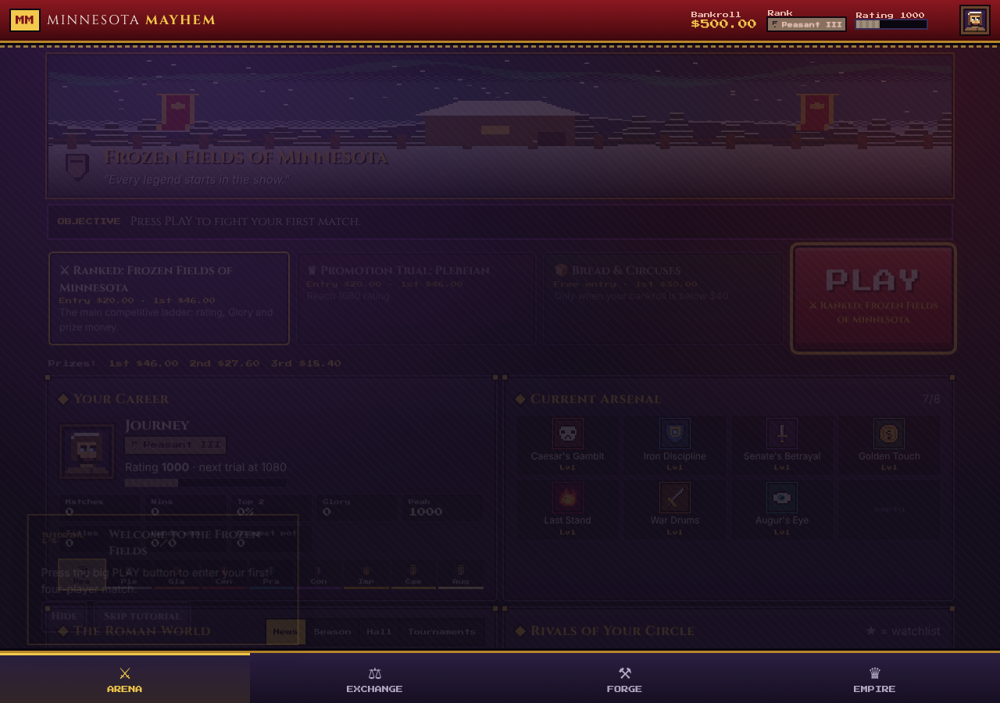
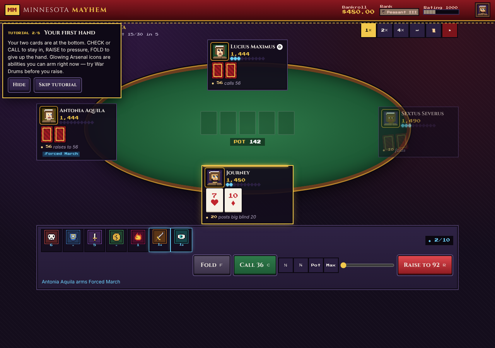
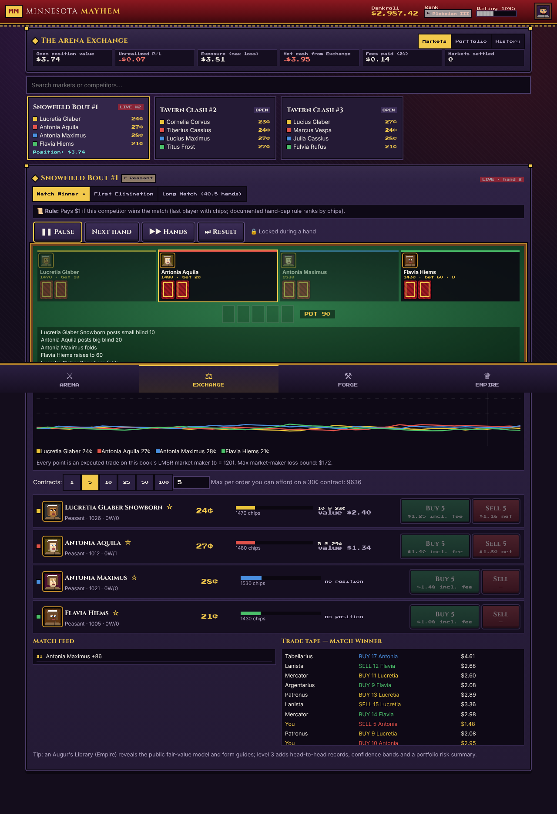
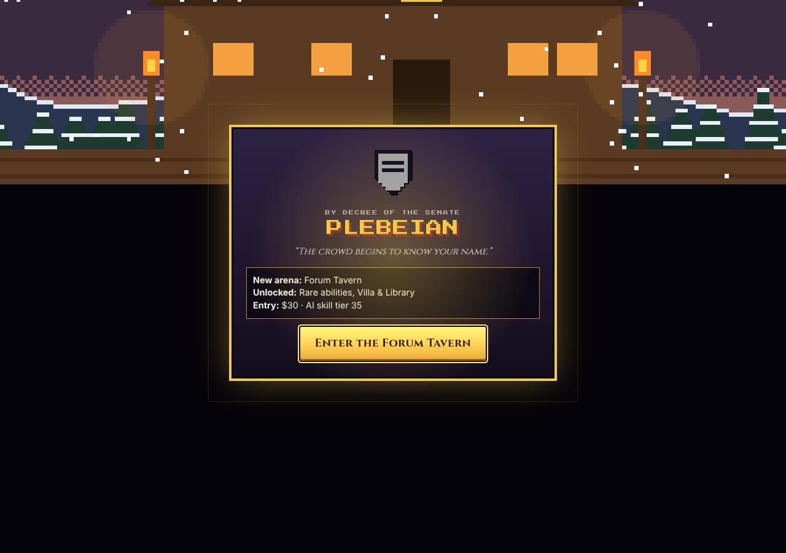
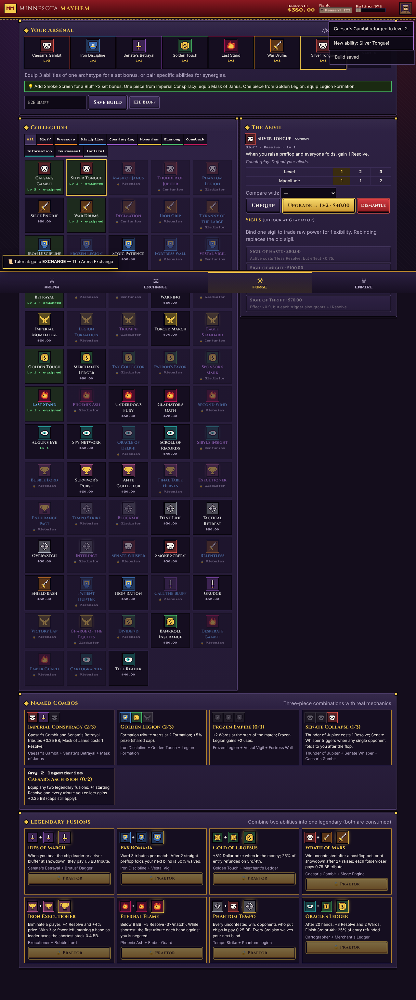
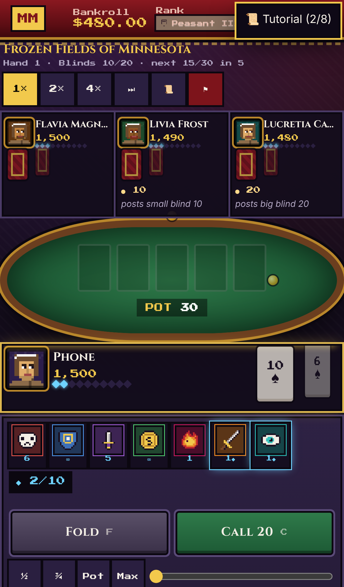

# MINNESOTA MAYHEM 2.0 — *IMPERIAL ASCENSION*

*Roman Poker · Strategic Arsenals · The Arena Exchange · Empire*

A complete, original, fully local Roman-themed poker strategy game. Rise from **Peasant** to **Augustus** in fast four-player No-Limit Hold'em matches. Build an eight-slot **Arsenal** from 76 tactical abilities across 10 archetypes, and chase five named combos. Trade prediction contracts on fully simulated AI matches in the **Arena Exchange**. Buy villas, clubs, colosseums and a palace for your **Empire**, while ~120 rivals rise, fall, retire and make the news around you.

No accounts, no servers, no paid APIs, no ads, no real-money wagering. Fictional Dollars only.

**What's new in 2.0:** see [`docs/CHANGELOG_2.0.md`](docs/CHANGELOG_2.0.md). It has the full before/after table, plus an honest list of what is completed, partial and not implemented.

| Arena | Match | Exchange (live spectator) |
|---|---|---|
|  |  |  |
|  |  |  |

## Play loops
* **PLAY → EARN → UPGRADE → CLIMB** — press PLAY for a ~3-minute ranked match, then win Dollars, upgrade in the Forge and earn your promotion trial.
* **RESEARCH → TRADE → INVEST** — three contract books per AI match: Winner, First Elimination and Long Match.
* **OWN → IMPROVE → PROFIT** — properties with upgrade levels, income and upkeep, and perks they unlock.
* New players see only the essentials. Seven extra modes unlock as you play: Quick Clash, Daily Challenge, Draft Arena, Rival Challenge, Survival Gauntlet, Imperial Tournament and High Roller. An 8-step tutorial teaches by doing.

## Quick start — Windows (one click after setup)
1. Install **Node.js LTS** from https://nodejs.org (one time).
2. Double-click **`Setup-Windows.bat`** (installs, builds, creates a desktop shortcut "Minnesota Mayhem").
3. From then on double-click the **desktop shortcut** (or `Play-Minnesota-Mayhem.bat`). A small console window runs the local server and your browser opens the game. Close that window to stop.

The launcher only runs `node server.mjs`, a ~60-line dependency-free static file server bound to `127.0.0.1:4173`. It requires no admin rights and does not change any Windows security setting.

macOS / Linux: `npm install && npm run build && ./play.sh`.

## Build commands
```bash
npm install
```
```bash
npm run build        # type-check, production build to dist/, generate offline service worker
```
```bash
npm run serve        # node server.mjs → http://localhost:4173
```
```bash
npm run dev          # hot-reload development server
```

## Playing on an iPhone (or any phone)
1. On the PC run **`Play-On-Phone.bat`** (or `node server.mjs --lan`). It prints an address such as `http://192.168.1.20:4173/`. If Windows Firewall asks, allow Node.js on **Private networks** only.
2. On the iPhone (same Wi-Fi) open that address in **Safari**. The interface is touch-first (44 px+ targets, single-screen match layout).
3. **Limitations, honestly:** browsers only allow offline service workers on `https://` or `localhost`. Over plain LAN `http://` the phone plays fine *while the PC server is running*, but it will **not** work offline and it is **not** a permanently installed app. "Add to Home Screen" gives a full-screen icon, but it still needs the server.
4. For true offline on iPhone, host the static `dist/` folder on any free HTTPS static host (e.g. GitHub Pages, Netlify, Cloudflare Pages) — no server logic is needed — open it once in Safari, then **Share → Add to Home Screen**. iOS may evict data of home-screen web apps that go unused for weeks; **export backups** (below).
5. Saves live in each browser separately — the PC and the phone have different careers. Move a career with Export/Import.

## Offline use
After the first load from `localhost`, a service worker caches every asset (`dist/sw.js`, generated by `scripts/build-sw.mjs`). The game then starts and plays with networking disabled (verified by the automated playthrough). All fonts and sounds are bundled or synthesised locally; nothing is fetched from the internet.

## Saves & backups
* Auto-save to **IndexedDB** after every action, using two alternating slots (an interrupted write leaves the previous save intact) plus a `localStorage` backup copy; saved again when the tab is hidden or closed.
* Saves are versioned (`SAVE_VERSION`, with migrations) and protected by a checksum; corrupted or edited saves are rejected and the previous good slot is restored automatically.
* In-progress matches and live markets are saved and resume deterministically (seeded RNG).
* **Backup:** EMPIRE → Settings & Saves → **Export save** downloads a `.json` file. **Import save** (also on the title screen) restores it. Do this regularly: clearing site data, private browsing, or iOS storage eviction erases browser storage.

## Project structure
```
src/core/            pure TypeScript simulation (no DOM) — fully unit-tested
  arsenal2.ts          expansion ability hooks (cooldowns, combos, tournament & tactical archetypes)
  modes.ts world.ts    game modes; news, seasons, Hall of Champions, retirement, reputation
  rng.ts               seeded sfc32 RNG (no Math.random in simulation)
  cards.ts handEval.ts 7-card hand evaluator
  poker.ts             NL Hold'em tournament engine: betting legality, side pots, eliminations
  equity.ts ai.ts      Monte-Carlo equity from public info; personality-driven AI
  abilities.ts         44 Arsenal abilities, sigils, synergies, set bonuses
  match.ts             match orchestration, Resolve, effect queue & resolution order
  ranks.ts rivals.ts   ranks, Elo, trials; persistent procedural rivals
  lmsr.ts market.ts    LMSR market maker, simulated traders, positions, settlement
  empire.ts game.ts    economy ledger, Forge, Empire, world simulation, achievements
  save.ts              versioned/checksummed saves, IndexedDB two-slot persistence
src/ui/              React screens (Arena, Match, Exchange, Forge, Empire)
src/art/             procedural pixel portraits, sprites, animated arena scene, WebAudio SFX
tests/               Vitest suites (56 tests)
scripts/             balance harness, browser playthrough, icon & service-worker generators
docs/                DESIGN.md (rules), BALANCE_REPORT.md, TEST_RESULTS.txt, E2E_RESULTS.json, screenshots/
server.mjs           dependency-free local server;  *.bat / play.sh launchers
```

## Verification
| Check | Command | Result |
|---|---|---|
| Unit & integration tests | `npm test` | **72/72 pass** — `docs/TEST_RESULTS.txt` |
| 25-step browser journey (desktop, offline, iPhone 13) | `npm run build && npm run serve`, then `npm run test:e2e` | **27/27 checks** (25 steps + no runtime errors on desktop & mobile) — `docs/E2E_RESULTS.json`, screenshots in `docs/screenshots/v2/` |
| Version 1 regression journey | `npm run test:e2e:v1` | V1 results kept in `docs/E2E_RESULTS_V1.json` |
| Balance & AI benchmark | `npm run balance` | `docs/BALANCE_REPORT.md` (V1 baseline: `docs/BALANCE_REPORT_V1.md`) |
| Ability coverage | `COVERAGE_MAIN=1 npx vite-node scripts/ability-coverage.ts` | trigger counts for all 76 abilities |

### Save migration
A Version 1 save (schema 3) loads automatically. Before migrating, the untouched original is copied to `backup-v3` in IndexedDB. Ability IDs, properties, rival records, active markets, transactions, prestige and even an in-progress match all carry over. This is verified by a unit test and by a browser import of a frozen real V1 save (`tests/fixtures/v1-save.json`).

## Known limitations
* **Not a native app.** True offline iPhone play requires hosting `dist/` on HTTPS (any free static host); LAN play from the PC needs the PC running.
* **Arsenal size:** 76 abilities, not 100+. Only abilities with distinct, coverage-tested mechanics were added.
* **Exchange:** no tournament-champion or promotion markets, and no limit orders.
* **Pre-match prices barely predict winners** (Brier ≈ uniform). In a 4-player poker knockout, ratings carry little signal. Live prices between hands, driven by public chip counts, are much more informative (see balance report §8).
* **Simulated traders are funded by the LMSR subsidy** (~$110 per market, always within the theoretical bound). Momentum traders lose; value traders profit.
* **AI:** strong heuristic + Monte-Carlo, not a solver. Its memory of you is public statistics only.
* **Audio:** synthesized effects only, no music. Art is procedural and hand-authored pixel art.
* **Balance figures come from AI-vs-AI simulation;** human play will shift them.
* **Saves are per browser/device;** use Export/Import to move a career.
