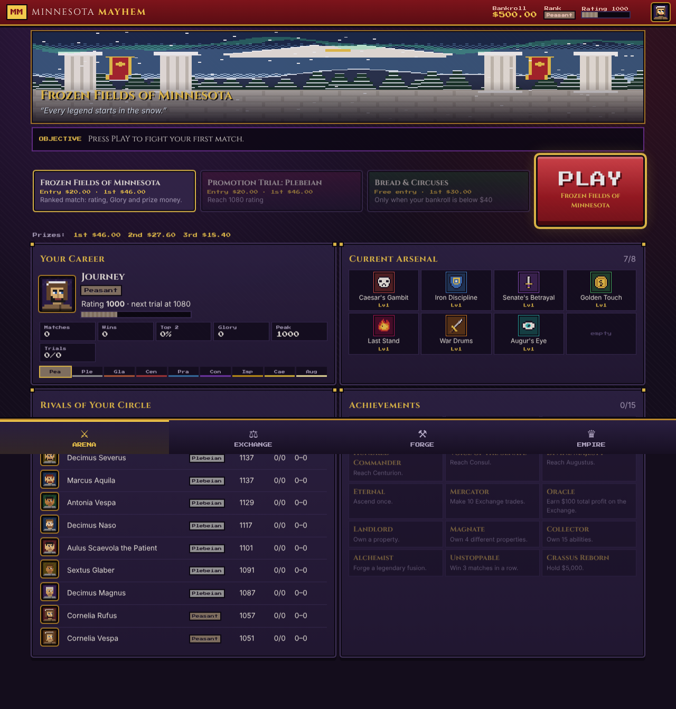
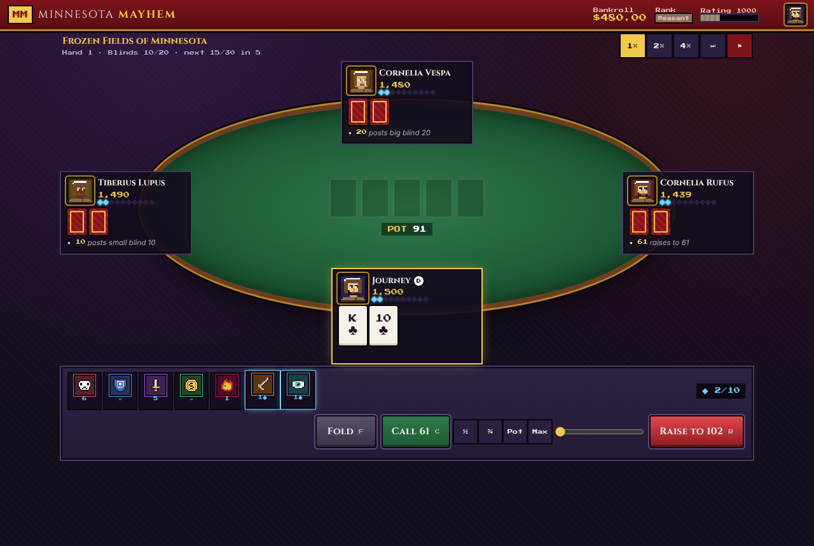
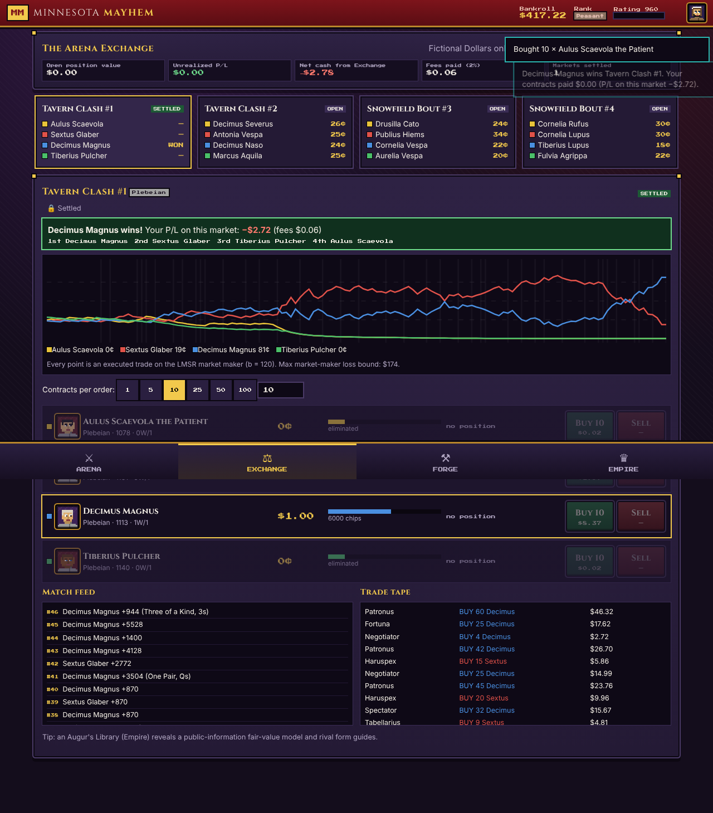

# MINNESOTA MAYHEM

*Roman Poker · Strategic Arsenals · The Arena Exchange · Empire*

A complete, original, fully-local Roman-themed poker strategy game. Rise from **Peasant** to **Augustus** in fast four-player No-Limit Hold'em tournaments, build an eight-slot **Arsenal** of tactical abilities, trade prediction contracts on AI-only matches in the **Arena Exchange**, and invest your Dollars in an **Empire** of villas, clubs and colosseums — all in 16-bit Roman pixel style on a snowy Minnesota frontier.

No accounts, no servers, no paid APIs, no ads, no real-money wagering. Fictional Dollars only.

| Arena | Match | Exchange |
|---|---|---|
|  |  |  |

## Play loops
* **PLAY → EARN → UPGRADE → CLIMB** — ranked 4-player matches (≈3 min), prize money, Forge upgrades, promotion trials.
* **RESEARCH → TRADE → SETTLE → INVEST** — LMSR prediction markets on fully simulated AI matches, property income.

## Quick start — Windows (one click after setup)
1. Install **Node.js LTS** from https://nodejs.org (one time).
2. Double-click **`Setup-Windows.bat`** (installs, builds, creates a desktop shortcut "Minnesota Mayhem").
3. From then on double-click the **desktop shortcut** (or `Play-Minnesota-Mayhem.bat`). A small console window runs the local server and your browser opens the game. Close that window to stop.

The launcher only runs `node server.mjs`, a ~60-line dependency-free static file server bound to `127.0.0.1:4173`. It requires no admin rights and does not change any Windows security setting.

macOS / Linux: `npm install && npm run build && ./play.sh`.

## Build commands
```bash
npm install
```
```bash
npm run build        # type-check, production build to dist/, generate offline service worker
```
```bash
npm run serve        # node server.mjs → http://localhost:4173
```
```bash
npm run dev          # hot-reload development server
```

## Playing on an iPhone (or any phone)
1. On the PC run **`Play-On-Phone.bat`** (or `node server.mjs --lan`). It prints an address such as `http://192.168.1.20:4173/`. If Windows Firewall asks, allow Node.js on **Private networks** only.
2. On the iPhone (same Wi-Fi) open that address in **Safari**. The interface is touch-first (44 px+ targets, single-screen match layout).
3. **Limitations, honestly:** browsers only allow offline service workers on `https://` or `localhost`. Over plain LAN `http://` the phone plays fine *while the PC server is running*, but it will **not** work offline and it is **not** a permanently installed app. "Add to Home Screen" gives a full-screen icon, but it still needs the server.
4. For true offline on iPhone, host the static `dist/` folder on any free HTTPS static host (e.g. GitHub Pages, Netlify, Cloudflare Pages) — no server logic is needed — open it once in Safari, then **Share → Add to Home Screen**. iOS may evict data of home-screen web apps that go unused for weeks; **export backups** (below).
5. Saves live in each browser separately — the PC and the phone have different careers. Move a career with Export/Import.

## Offline use
After the first load from `localhost`, a service worker caches every asset (`dist/sw.js`, generated by `scripts/build-sw.mjs`). The game then starts and plays with networking disabled (verified by the automated playthrough). All fonts and sounds are bundled or synthesised locally; nothing is fetched from the internet.

## Saves & backups
* Auto-save to **IndexedDB** after every action, using two alternating slots (an interrupted write leaves the previous save intact) plus a `localStorage` backup copy; saved again when the tab is hidden or closed.
* Saves are versioned (`SAVE_VERSION`, with migrations) and protected by a checksum; corrupted or edited saves are rejected and the previous good slot is restored automatically.
* In-progress matches and live markets are saved and resume deterministically (seeded RNG).
* **Backup:** EMPIRE → Settings & Saves → **Export save** downloads a `.json` file. **Import save** (also on the title screen) restores it. Do this regularly: clearing site data, private browsing, or iOS storage eviction erases browser storage.

## Project structure
```
src/core/            pure TypeScript simulation (no DOM) — fully unit-tested
  rng.ts               seeded sfc32 RNG (no Math.random in simulation)
  cards.ts handEval.ts 7-card hand evaluator
  poker.ts             NL Hold'em tournament engine: betting legality, side pots, eliminations
  equity.ts ai.ts      Monte-Carlo equity from public info; personality-driven AI
  abilities.ts         44 Arsenal abilities, sigils, synergies, set bonuses
  match.ts             match orchestration, Resolve, effect queue & resolution order
  ranks.ts rivals.ts   ranks, Elo, trials; persistent procedural rivals
  lmsr.ts market.ts    LMSR market maker, simulated traders, positions, settlement
  empire.ts game.ts    economy ledger, Forge, Empire, world simulation, achievements
  save.ts              versioned/checksummed saves, IndexedDB two-slot persistence
src/ui/              React screens (Arena, Match, Exchange, Forge, Empire)
src/art/             procedural pixel portraits, sprites, animated arena scene, WebAudio SFX
tests/               Vitest suites (56 tests)
scripts/             balance harness, browser playthrough, icon & service-worker generators
docs/                DESIGN.md (rules), BALANCE_REPORT.md, TEST_RESULTS.txt, E2E_RESULTS.json, screenshots/
server.mjs           dependency-free local server;  *.bat / play.sh launchers
```

## Verification
| Check | Command | Result |
|---|---|---|
| Unit & integration tests (areas 1–20, 23, 24) | `npm test` | **56/56 pass** — see `docs/TEST_RESULTS.txt` |
| Browser playthrough (journey steps 1–15, offline (21), iPhone viewport (22)) | `npm run build && npm run serve` then `npm run test:e2e` | **19/19 pass** — see `docs/E2E_RESULTS.json`, `docs/screenshots/` |
| Balance simulations | `npm run balance` | see `docs/BALANCE_REPORT.md` |

Test coverage map: hand rankings, ties, betting legality, side pots, all-in, eliminations (`poker.test.ts`); Arsenal timing, combo resolution & chip conservation over full matches with random 8-ability loadouts, AI information boundaries, determinism (`arsenal.test.ts`); rating, trials, Dollar ledger, Forge, property, LMSR pricing, execution, positions, settlement, MM loss bound, cancellation/refunds, trading locks, bankruptcy recovery (`meta.test.ts`); save/load round-trip incl. live match & market, deterministic restoration, corruption, migration, IndexedDB slot recovery, 40-match career invariants (`save.test.ts`).

### Balance highlights (from `docs/BALANCE_REPORT.md`)
* 720 AI matches: median **41 hands ≈ 3.1 minutes** at human pace (p90 3.7 min); max 59 hands; the hand-cap safety rule never fired.
* Archetype win rates (fair share 25%): every archetype between **16% and 35%** at every tier tested — no dominant build.
* The harness caught and fixed real problems: Last Stand's refund could take a winner's entire late-game stack (now bounded by contribution and half the winner's gain; win-rate impact cut from +13 to ~+4 points); Legion Formation and Tax Collector were over-tuned; market priors over-rated favourites (re-calibrated by log-loss over 500 matches); early ranks were too slow (podium bonus added).
* Simulated competent player: Plebeian after ~8 matches, Gladiator ~19, Centurion ~49; the top ranks remain demanding (Caesar reached in 2 of 6 140-match careers).
* Broke players were never stuck: recovery to a ranked entry took a median of 1 free match (max 3).
* Exchange: naive strategies lose slowly to fees and spread; the LMSR loss bound was never violated.

## Known limitations
* **Not a native app.** It is a web app/PWA. True offline iPhone play requires hosting `dist/` on HTTPS yourself (free static hosts work); LAN play from the PC is online-only (see above).
* Sound effects are simple synthesised chip/card blips and fanfares — no music.
* Art is procedural/hand-authored pixel art (portraits, buildings, icons, arena scenes); there are no character animations beyond cards, banners, snow and aurora.
* The AI is a solid heuristic + Monte-Carlo player, not a solver; strong human players will find exploits, and the top ranks are tuned to be hard for a mid-skill bot rather than for a perfect player.
* Balance numbers come from AI-vs-AI simulation; human playtesting will shift them. Information abilities mainly help *you* (equity, pot odds, opponent stats); for AI rivals they are modelled as sharper reading of public stats plus wards.
* The Exchange's simulated traders are funded by an LMSR subsidy (≈$110 per market on average, always within the theoretical bound); this is fiction, not a model of a real exchange.
* Rival background matches are summarised (statistical) for performance; only your matches and Exchange matches are fully simulated hand-by-hand.
* Saves are per browser/device; there is no cloud sync by design.
